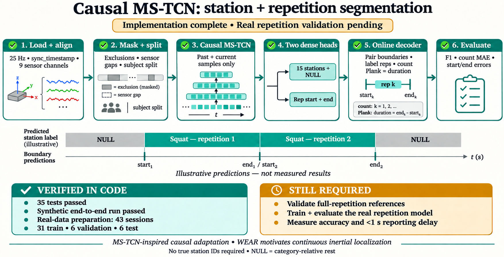

# Causal temporal action segmentation and repetition counting

This implements the method requested in `plan.md`: continuous wearable inputs,
15 station classes plus **NULL** (the existing `rest` label), and a second dense
head for individual repetition starts and ends. Inference needs sensor values
and their synchronized timestamps; it never receives station IDs, labels, set
boundaries, or repetition boundaries.

The confirmed two-head design is **station/NULL classification + independent
start/end boundary probabilities**. It is a project-specific, causal adaptation
of [MS-TCN (Abu Farha and Gall, CVPR 2019)](https://openaccess.thecvf.com/content_CVPR_2019/html/Abu_Farha_MS-TCN_Multi-Stage_Temporal_Convolutional_Network_for_Action_Segmentation_CVPR_2019_paper.html),
with continuous inertial localization motivated by
[WEAR (Bock et al., IMWUT 2024)](https://mariusbock.github.io/wear/).
WEAR's benchmark architectures include ActionFormer and TriDet; this is not an
exact reproduction of a WEAR model. The original MS-TCN is noncausal and has a
single action head. The causal padding and repetition head are additions here.



## Current status

- Implemented: exclusions and availability masks, exact-clock loading, preserved
  phase annotations, subject splits, training-only normalization, causal staged
  model, both losses, training/checkpoints, validation threshold selection,
  streaming decoder, repetition/hold/set outputs, classification and repetition
  evaluation, and an end-to-end synthetic demo.
- Verified on November 16, 2026: **35 tests passed**, synthetic training → tuning
  → held-out evaluation → sensor-only inference passed, and a two-batch real-data
  station-classification training/validation check passed.
- Real waist data prepared: **43 subjects/sessions**, **31 train / 6 validation /
  6 test**, **71.3921 eligible sensor-hours**, and **57.2333 sensor-minutes** in
  the separate, unscored sled-pull mask. These are selected-waist coverage counts,
  not the all-device dataset totals in the plan.
- Still needed for a real repetition experiment: validated full-repetition
  references and coverage, full training, held-out performance evaluation, and
  end-to-end reporting-delay measurement. No real repetition model has been
  trained or evaluated. Synthetic and two-batch runs establish code execution,
  not useful accuracy. The method does not yet establish the <1 second target.
- The user confirmed the two-head design and that a validated repetition
  convention/reference file is not currently available. Reference import is
  ready for when those labels become available; real repetition training and
  scoring remain pending. The synthetic demo and station/NULL baseline can run now.

## Install and run a complete example

Run from the repository root (`/home/arjun/zahra` in this workspace). Python 3.10+
is required; verification used Python 3.12 and CPU PyTorch.

```bash
python3 -m venv .venv
source .venv/bin/activate
python -m pip install torch --index-url https://download.pytorch.org/whl/cpu
python -m pip install -r strength_training/temporal_segmentation/requirements.txt

python -m strength_training.temporal_segmentation demo \
  --output strength_training/tas_runs/my_demo

python -m unittest discover -s strength_training -p 'test_*.py' -v
```

The demo generates eight synthetic subjects with known repetition boundaries,
trains a small model for two short epochs, selects decoder thresholds on validation
subjects, evaluates the test subject, and replays a sensor CSV one sample at a time.
Its weights are only for testing the plumbing. The selected small model may
produce no repetitions after such brief training; perfect constructed
probabilities in the decoder tests check that adjacent reps are counted correctly.

Outputs include:

| File under `my_demo/` | Contents |
| --- | --- |
| `prepared/manifest.json` | Exclusions, subject partitions, train statistics, reference coverage |
| `model/best.pt` | Best checkpoint by validation loss |
| `model/history.json` | Training and validation losses |
| `decoder.json` | Validation-selected decoder parameters and matching tolerance |
| `evaluation/report.json` | Classification, counts, detection, timing, and coverage results |
| `prediction/events.jsonl` | Repetition events written as they are detected |
| `prediction/frames.csv` | Dense station, confidence, start/end probabilities |
| `prediction/predictions.json` | Reps, per-station counts, plank durations, derived sets, runtime timings |

All output commands refuse to overwrite existing destinations. Choose another
output name to repeat a run. In this workspace, completed checks are already in
`strength_training/tas_runs/demo/` and `strength_training/tas_runs/real_data_smoke/`.

## Prepare real recordings

```bash
python -m strength_training.temporal_segmentation prepare \
  --source strength_training/strength_training_data_clean \
  --alignment strength_training/data_demographics/tables/log_clock_alignment.csv \
  --location waist \
  --output strength_training/tas_data_waist_new
```

The verified preparation already exists at `strength_training/tas_data_waist/`.
Use that path for the next command if working in this existing workspace.
Preparation reads the cleaned CSVs directly; running `prepare_data.py` first is
not necessary. Source CSVs are never modified.

`--location` accepts `waist`, `left_wrist`, or `right_wrist`. This is a single-body-
location baseline. For multiple waist devices, it selects the lexicographically
first filename, independently of labels and exercise coverage, and records that
choice. It never switches to wrist labels for waist data. Missing wrist sessions
are explicitly excluded. Availability cohorts can differ across locations, so
compare baselines only on a declared common subject cohort; the default splits
are seeded independently for each prepared cohort.

The loader performs these steps before generating any training windows:

1. Remove all four plan-excluded sessions, including their potential probes.
2. Read the existing alignment audit. For sessions with `action`, `spull`, or
   `Other`, require an accepted offset (match fraction > .5 and margin > .1).
   Interpret the inferred offset as `sensor_epoch = log_wall_time - offset`.
3. Mask calibration, sled pulls, and failed-recording intervals. Preserve sled
   pulls separately in `probe.npy`; calibration/failure masks take precedence.
4. Quarantine sessions whose affected intervals cannot be placed confidently.
   Ordinary walking and inter-set rest remain eligible elsewhere.
5. Join each selected sensor exactly to the 40 ms label grid using
   `sync_timestamp`. Use only the nine accelerometer/gyroscope/magnetometer
   columns as inputs. Embedded labels and both clock columns are excluded from
   feature tensors. No interpolation or forward filling is applied.
6. Preserve original location labels in `raw.npy`; normalize phase and transition
   suffixes only for the separate station target. Availability and eligibility
   remain separate masks.
7. Split by complete subject ID, then fit means, standard deviations, class
   weights and boundary imbalance weights using training subjects only.

The real-data check excluded these additional sessions pending review:

| Session | Reason |
| --- | --- |
| `20260602_SSCDLRFV` | Unresolved log offset |
| `20260603_MGTNMGTNOWZB` | Unresolved log offset |
| `20260605_DQTQVVZPOGPA` | Unresolved log offset |
| `20260617_WTTALRFVDQTQ` | `Other` entry has `/` for both affected interval times |

Use a corrected, evidence-backed alignment audit for unresolved offsets. The
invalid `Other` interval also needs a trustworthy temporal extent before this
session can be included. The code does not guess that missing times mean rest.

The preparation exports `unverified_phase_candidates.json` for each retained
session. These list adjacent phase1→phase2 runs **for inspection only**. There
were 20,418 such candidates on the selected waist timelines, before filtering
them for training eligibility. They are not validated reps, not counts, and are
never used as training or scoring targets.

## Station classification diagnostic, runnable now

Without validated repetition references, the following intentionally trains only
the supporting station/NULL task:

```bash
python -m strength_training.temporal_segmentation train \
  --data strength_training/tas_data_waist \
  --station-only --epochs 30 \
  --output strength_training/tas_runs/station_baseline

python -m strength_training.temporal_segmentation evaluate \
  --data strength_training/tas_data_waist \
  --checkpoint strength_training/tas_runs/station_baseline/best.pt \
  --output strength_training/tas_runs/station_baseline_test
```

This checkpoint deliberately emits no repetition events. Station recognition
alone does not complete the study's repetition objective. Omit `--max-steps` for
real experiments; that argument is a diagnostic cap, recorded in the checkpoint.

## Validated repetition references

The repository does not establish whether phase1→phase2 is a full repetition for
each exercise, how transitions/pauses are treated, or which intervals have
exhaustive valid repetition annotations. Training the boundary head and scoring
counts therefore require an explicit reference JSON. This can come from existing
validated annotations or a validated interpretation of the current phase labels;
it does not require manual inter-set boundary labels.

Start with `references.example.json`. The schema for a populated entry is:

```json
{
  "version": 1,
  "sessions": {
    "YYYYMMDD_FULL_MASKED_ID": {
      "validated": true,
      "location": "waist",
      "source": "Description/path of the checked annotation source",
      "convention": "Exercise-specific full-cycle rule; pause and partial-cycle policy",
      "coverage": [
        {"start_ms": 1000000, "end_ms": 1010000}
      ],
      "repetitions": [
        {"station": "squat", "start_ms": 1000800, "end_ms": 1002800},
        {"station": "squat", "start_ms": 1002800, "end_ms": 1004800}
      ]
    }
  }
}
```

The numbers and session key above are illustrative: replace them with actual
`sync_timestamp` values. Set `validated` to true only after checking the reference
interpretation. Describe separate exercise conventions in the `convention` text.

- All intervals use **[start_ms, end_ms)** on the session's 40 ms grid.
- `coverage` certifies **exhaustive annotation of all complete dynamic reps** in
  that region, including regions containing zero reps. It is not just a list of
  positive snippets. Uncertain/incomplete-reference regions should stay outside
  reference coverage; they can still train the station head when otherwise valid.
- A repetition and its exclusive end tick must be inside one coverage interval.
  This allows a causal end target at the first sample after the completed rep.
- Repetitions must be ordered, nonoverlapping, and use the exact class strings in
  `constants.py`. Adjacent repetitions may share an end/start tick.
- Plank has no repetition references; it is reported as hold duration.
- References crossing an excluded or missing-sensor interval are removed, and
  their entire span is removed from boundary supervision. Removals are reported.
- Separate body-location references are required when timing semantics differ.

`prepare` without references works normally, but two-head training refuses to
start without validated repetitions in both training and validation partitions.
Evaluation reports missing reference coverage instead of fabricated zero counts.

## Train and evaluate both heads

After validating the references:

```bash
python -m strength_training.temporal_segmentation prepare \
  --location waist \
  --references /absolute/path/to/validated_repetitions.json \
  --output strength_training/tas_data_reps

python -m strength_training.temporal_segmentation train \
  --data strength_training/tas_data_reps \
  --epochs 30 \
  --output strength_training/tas_runs/repetitions

python -m strength_training.temporal_segmentation tune \
  --data strength_training/tas_data_reps \
  --checkpoint strength_training/tas_runs/repetitions/best.pt \
  --tolerance-ms 400 \
  --output strength_training/tas_runs/repetitions/decoder.json

python -m strength_training.temporal_segmentation evaluate \
  --data strength_training/tas_data_reps \
  --checkpoint strength_training/tas_runs/repetitions/best.pt \
  --decoder strength_training/tas_runs/repetitions/decoder.json \
  --split test \
  --output strength_training/tas_runs/repetition_test
```

Use `--device cuda` if your environment has a compatible GPU PyTorch installation.
Default execution is CPU. `tune` always uses validation subjects and never accepts
a test split. The example 400 ms endpoint tolerance is a declared starting
protocol, not an empirically established optimal value; choose it using training/
validation evidence before the test evaluation. It is saved with the decoder.
Threshold search maximizes one-to-one repetition F1 and breaks ties with count MAE.
The default search varies boundary and station-confidence thresholds; duration
limits and hysteresis settings remain declared defaults. A checkpoint hash binds
the chosen thresholds to the corresponding model.

## Sensor-only prediction and online use

```bash
python -m strength_training.temporal_segmentation predict \
  --checkpoint strength_training/tas_runs/repetitions/best.pt \
  --decoder strength_training/tas_runs/repetitions/decoder.json \
  --input strength_training/strength_training_data_clean/20260602_LRFVFZEIVGAM/S1_waist.csv \
  --chunk 1 \
  --output strength_training/tas_runs/session_prediction
```

Use a sensor at the **same body location as training**. The example path shows the
CSV format, not an assertion that that session belongs to the test partition;
use `evaluate --split test` for held-out results. All embedded labels are ignored.
Raw `predict` is deliberately unscored and does not read workout logs or targets;
research exclusions are applied by `prepare` and `evaluate`.

Each repetition contains `station`, `start_ms`, `end_ms`, confidence, and the
sample-time `reported_at_ms`. Counts are grouped per predicted station. Plank
holds are separate; sets are a secondary grouping by station and a 10 s gap.
Sensor gaps reset the model and decoder. Unfinished cycles at gaps, timeouts, or
EOF are discarded. EOF-truncated plank holds are marked.

The reusable live components are `DenseMSTCN.stream()` and `RepDecoder.step()`.
Feed training-normalized sensor samples to `stream`, then its softmax/sigmoid
outputs to `step`; reset both states on a timestamp gap or session change. The
CLI replays a CSV and flushes completed events to JSONL; it is not a hardware
acquisition driver.

At 25 Hz, `--chunk 1` adds no deliberate buffering. Sizes up to 20 are accepted
(maximum 760 ms buffering), but that leaves less of the one-second budget for
computation, transport, and model boundary error. Runtime p50/p95/max, per-event
compute time, and buffering delay are saved. These are **relative to predicted
ends**. True reporting delay also includes error relative to the validated end
time, sensor transport and any processing backlog. Causality alone cannot prove
the requested <1 s performance.

## Model, losses and scoring

`model.py` defaults to 3 stages, 6 residual dilated convolutions per stage,
64 channels, and dilation factors 1, 2, 4, 8, 16, 32. Left-only padding preserves
the 25 Hz resolution. The combined receptive history is 378 past samples
(15.12 s), with no future lookahead. Cached per-layer state makes streaming
mathematically equivalent to full causal inference in evaluation mode.

Each stage produces 16 station logits and 2 boundary logits. Refinement consumes
the previous stage's predicted station and boundary probabilities. The loss is
the mean over stages of:

`weighted station CE + 0.15 × truncated log-probability smoothing + boundary BCE`

Smoothing is capped at 16 and detaches the preceding prediction, following the
[authors' implementation](https://github.com/yabufarha/ms-tcn/blob/master/model.py).
Both adjacent samples must be eligible. Boundary BCE is restricted to validated
coverage; independent sigmoid outputs support a simultaneous end and next start.
Class imbalance weights come from training data. No smoothing is applied to
boundary impulses. Windows include preceding causal context, but only their
central samples contribute to losses. Windows never cross eligibility gaps.

The decoder uses hysteresis and a 200 ms same-event refractory period. Starts
and ends are paired subject to 240 ms–30 s duration limits; new starts replace
incomplete cycles. A completed interval receives the most probable station from
the average predicted probabilities across the interval. NULL, plank, and
low-confidence intervals do not become dynamic reps. These are baseline rules
to validate; they do not assume exercise-specific speeds or physical sensor units.

Reports include:

- Station/NULL macro F1, per-class precision/recall/F1, support and confusion
  matrix; binary exercise/rest F1; and entirely-rest false exercise runs per
  eligible annotated rest hour. Macro F1 over all 16 classes and over supported
  classes are distinguished.
- Repetition precision/recall/F1 using maximum-cardinality one-to-one matching,
  then minimum endpoint error. Both endpoints must be within the declared
  tolerance and predicted station labels must agree with references.
- Missed/extra repetitions, start/end MAE, and sample-time report delays for
  matched reps. Early reports are not treated as meeting a post-end deadline.
- Count MAE and exact-count accuracy per session/station, with both all 14
  dynamic classes and active station/session pairs reported. All-zero pairs
  therefore cannot conceal failure on active pairs.
- Per-subject/session and per-exercise results, exclusions and reference
  coverage. Counts refer only to covered intervals; predictions outside them or
  crossing their edges remain explicitly unscored.

Sled pulls remain outside standard scoring in `probe.npy`, with measurements in
`x.npy` and timestamps in `t.npy`. Their existing rest labels are never used to
evaluate unseen-exercise detection. No open-set claim is made: station identity
is inferred among the 15 current categories, and NULL is category-relative rest,
not a learned unknown-exercise detector. Broader station recognition belongs to
phase 2. The single-session-per-subject data and uneven demographic/exercise
coverage remain limitations.

## Files and verification

| File | Responsibility |
| --- | --- |
| `data.py` | Alignment, masks, reference validation, subject split, normalization |
| `model.py` | Causal multi-stage network, cached inference, masked losses |
| `decode.py` | Online rep pairing, hold durations, secondary set grouping |
| `metrics.py` | Classification, matching, counts and boundary metrics |
| `runner.py` | Training, validation-only tuning, evaluation and CSV inference |
| `demo.py` | Synthetic annotated fixture and full pipeline smoke run |
| `tests/test_pipeline.py` | Causality, masks, leakage, decoding and metric regressions |
| `verification.json` | Recorded local execution results and package versions |

The workflow image was generated with the built-in image-generation tool and
saved in this project as `figures/workflow-v2.png`; its prompt is
[`figures/workflow.prompt.txt`](figures/workflow.prompt.txt).
